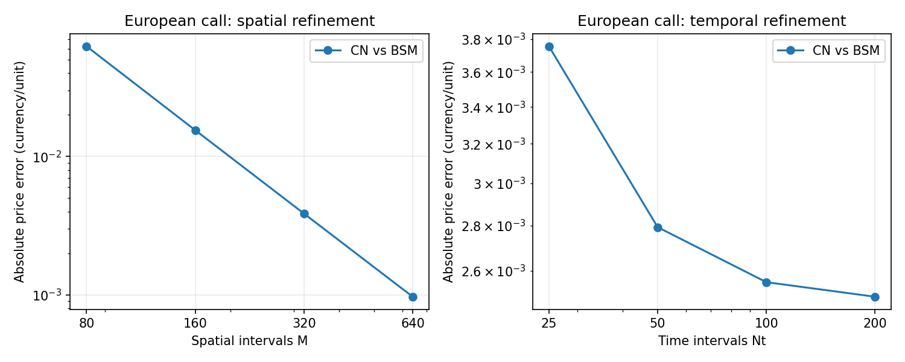
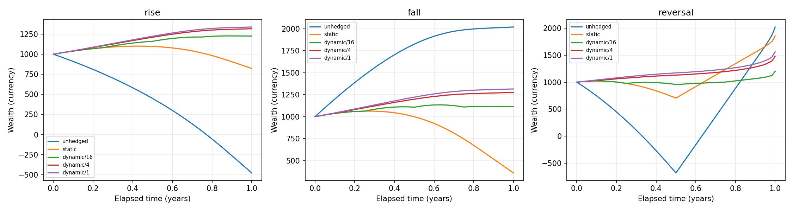

# Options Pricing and Risk Engine

**v1.0.0.** A Python research library for
European/American vanilla option pricing, risk and portfolio accounting. It
compares independent numerical methods and follows the financial effects of
exercise, shocks and Delta hedges through explicit cash ledgers.

[Technical report (PDF)](https://github.com/diracadjoint/quant-options-pricing/releases/download/v1.0.0/technical_report.pdf)
· [v1.0.0 release](https://github.com/diracadjoint/quant-options-pricing/releases/tag/v1.0.0)
· [Software DOI](https://doi.org/10.5281/zenodo.24118282)
· [Report DOI](https://doi.org/10.5281/zenodo.24118486)
· [Cite this software](CITATION.cff)

The report is licensed CC BY-SA 4.0; the code is MIT. Cite the software using
DOI `10.5281/zenodo.24118282` and the report using DOI `10.5281/zenodo.24118486`.

All experiments use synthetic data. The runtime core uses only Python's standard
library. The code is licensed under the [MIT License](LICENSE), approved by the
owner for v1.0.0. Copyright (c) 2026 Matheus de Oliveira Gomes. This code-license
decision is separate from the technical report's owner-approved **CC BY-SA 4.0**;
see the [code license record](docs/license_decision.md) and
[report license](docs/report_license.md).

## Available functionality

- European Black–Scholes–Merton prices and analytic Delta/Gamma/Vega/Theta/Rho,
  with continuous dividends and explicit degenerate cases.
- Independent European/American CRR trees and Crank–Nicolson/Rannacher finite
  differences with PSOR, residuals, exercise premium and grid contact boundaries.
- Numerical Greeks with bump/mesh studies, unavailable values and risk warnings.
- Signed positions/multipliers, aggregate risk, scenario P&L, expiry settlement
  and continuously compounded positive/negative cash balances.
- Unhedged, static and dynamic Delta hedge histories with stock, dividends,
  financing and self-financing reconciliation.

## Install and try

Python >=3.10. From the repository root:

```bash
python -m venv .venv
source .venv/bin/activate
python -m pip install -r requirements/dev.txt
python -m pip install --no-build-isolation -e '.[test]'
python examples/bsm_price.py
```

On Windows use `.venv\Scripts\activate`. Core-only installation: `python -m pip
install .`; no NumPy, SciPy or Matplotlib is required by pricing/risk modules.

```python
from options_engine import bsm_price, bsm_greeks, crr_price

call = bsm_price(100, 100, 1, 0.05, 0.20)  # 10.45058357218555
risk = bsm_greeks(100, 100, 1, 0.05, 0.20)
american_put = crr_price(100, 100, 1, 0.05, 0.20, option_type="put", steps=800)
print(call, risk.delta, american_put.price)
```

Detailed signatures, units and runnable portfolio/hedge examples are in the
[API and accounting reference](docs/api_reference.md).

## Test and reproduce

```bash
python -m pytest -m 'not slow' -q    # fast feedback
python -m pytest -m slow -q          # retained fine-grid / numerical-risk tests
python -m pytest -q                 # both groups
```

For the plotting workflow, use **Python 3.12** with the tested visualization lock:

```bash
python -m pip install -r requirements/visualization-py312.txt
python -m pip install --no-build-isolation -e '.[test,visualization]'
python examples/reproduce.py --mode quick --output work/quick-results
python scripts/verify_results.py work/quick-results
```

Full reproduction (several minutes) regenerates the extended studies and
original detailed example reports:

```bash
python examples/reproduce.py --mode full --output work/full-results-v1.0.0
python scripts/verify_results.py work/full-results-v1.0.0
python scripts/check_docs.py
```

Both modes generate CSV/JSON tables, eight PNG/SVG figure families and a manifest
with machine/package/source metadata and file hashes. Quick is representative;
full adds near-boundary, finer-bump and CRR risk studies. See the
[reproduction guide](docs/reproduction.md), [measured validation record](docs/v1_validation.md)
and [figure gallery](docs/gallery.md). Tests/experiments run offline after installation.
The committed artifacts retain their original `1.0.0rc1` execution metadata,
commit references and hashes. New runs go to work/ rather than overwriting that
historical evidence. Current preparation checks are in the
[v1.0.0 release record](docs/release_v1.0.0_validation.md).

## Representative measured results

For S=K=100, tau=1 year, r=.05, sigma=.20, q=0: European call **10.4505835722**,
put **5.5735260223**. American put CN/PSOR with M=640, Nt=200, Smax=400 gives
**6.08883942**; the refined CRR2400/2401 average is **6.09051979**, a comparison
reference rather than exact truth. The figures separate spatial/time errors and
show tree parity instead of assuming monotonic convergence.



The short-call hedge experiment starts at wealth 1000, uses the same 65-point
path grid for each strategy, and compares final wealth with **1051.27109638**
(initial wealth capitalized at r=.05). Dynamic/1 final wealth is 1338.92099701
on the rise path, 1315.64159935 on the fall and 1562.73426517 on the reversal.
These are deterministic stress outcomes, not performance guarantees; unhedged
or static positions can outperform dynamic hedges on an individual path.



Open scalable SVGs and inspect all methods, premiums, boundaries, Greek
stability, P&L and hedge attribution in the [gallery](docs/gallery.md). Tables
retain numerical flags and unavailable approximations at expiry.

## Assumptions and limits

Spot is strictly positive; strike positive; maturity/volatility nonnegative;
inputs finite and scalar. Parameters are constant and dividends continuous.
BSM/CRR accept negative rates/yields; **the PDE requires r,q>=0**. Greeks are
per absolute parameter unit, with calendar Theta per year. Public interfaces
and conventions are specified in [PROJECT_SPEC.md](PROJECT_SPEC.md).

American boundaries are mesh estimates. Default numerical bumps need stability
checks; interpolation and exercise transitions can make Gamma unreliable.
P&L adds second order only in spot and omits cross terms. Scenario shocks use
an explicit instantaneous-shock/flat-spot convention with expiry cash accrual.
Hedge paths are piecewise linear and self-financing; dividends are credited at
interval ends without intra-interval dividend interest. American hedge examples
hold to expiry and do not simulate early exercise/assignment. No market feed,
physical delivery, fees, margin or stochastic-path replication claim is included.

GitHub Actions define fast Python 3.10/3.12/3.13 checks and weekly/manual slow
validation plus full reproduction. The v1 publication workflow requires the full
suite and a separate full reproduction before creating the tag and release on
main. Actual execution status is available in GitHub Actions and
[Releases](https://github.com/diracadjoint/quant-options-pricing/releases).
Read the [release notes](docs/release_notes_v1.0.0.md),
[technical report PDF](docs/technical_report.pdf),
[report source](docs/technical_report.md) and
[Zenodo metadata](docs/zenodo_v1.0.0_proposal.md).
The owner authorized publication and selected CC BY-SA 4.0 for the report.
The owner confirmed the Zenodo publications: software DOI
[10.5281/zenodo.24118282](https://doi.org/10.5281/zenodo.24118282) and report DOI
[10.5281/zenodo.24118486](https://doi.org/10.5281/zenodo.24118486).
