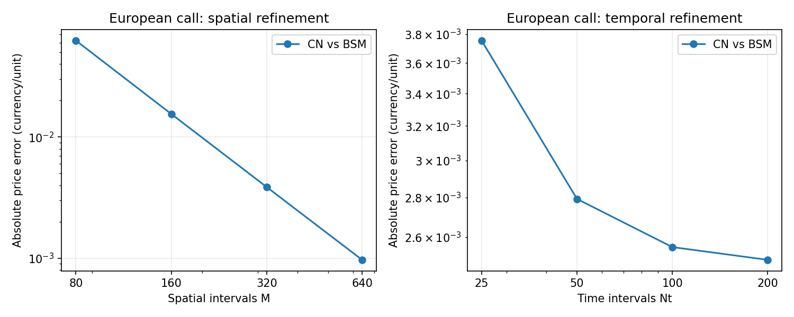
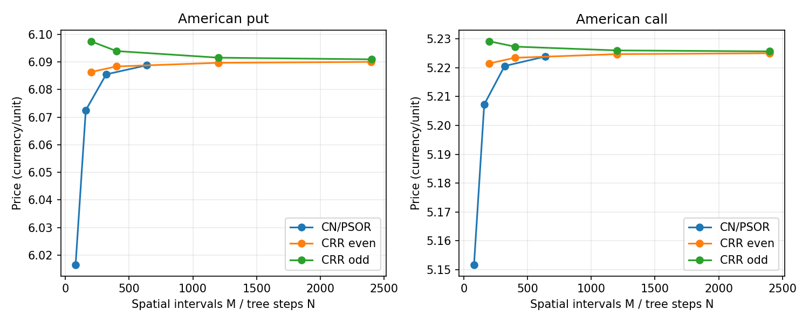
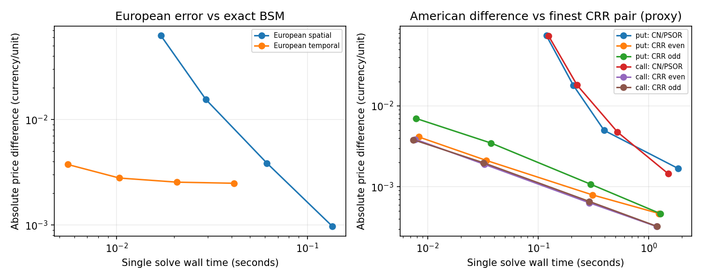
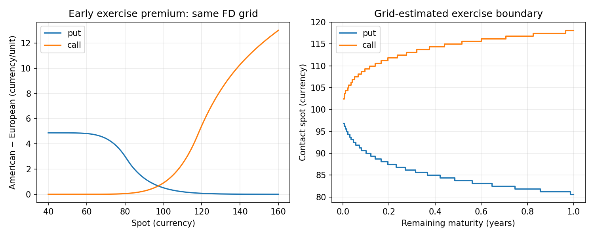
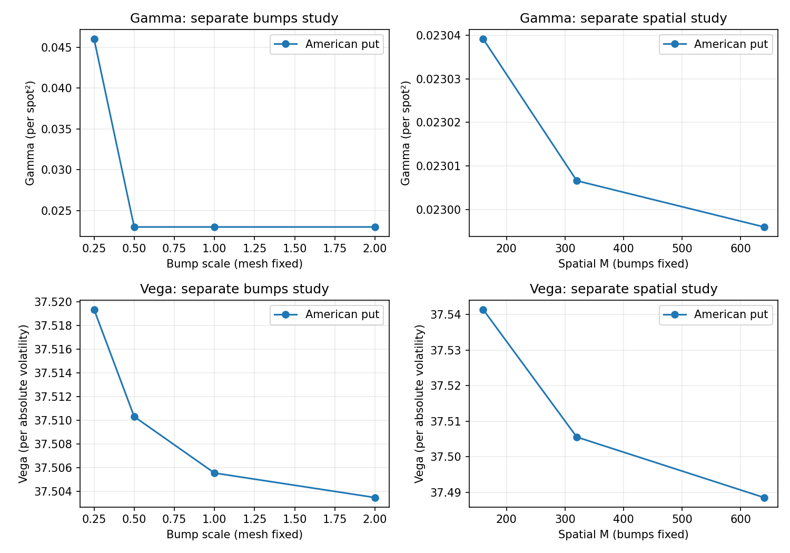
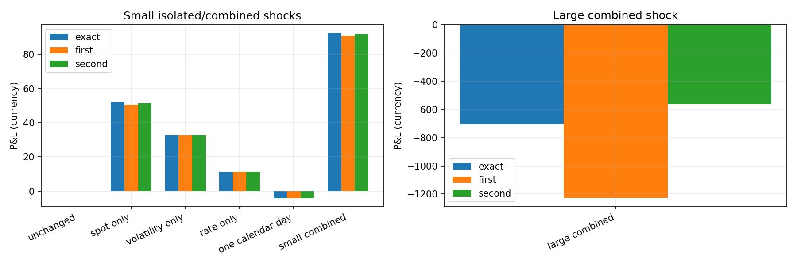
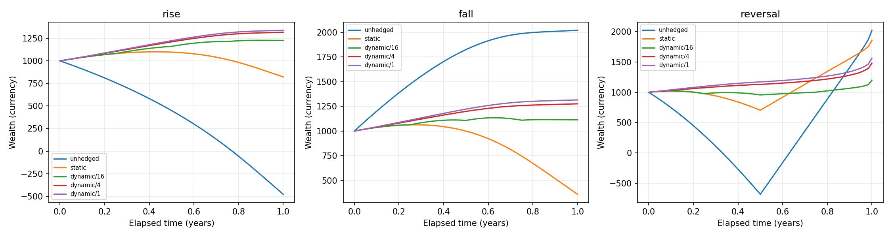
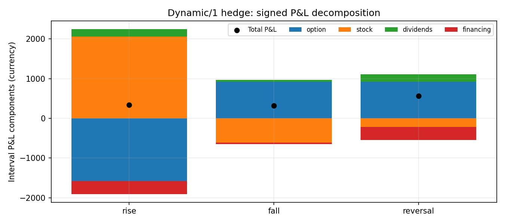

# Measured v1 experiment gallery

Historical measurements: these artifacts were generated with **1.0.0rc1** and
retain their original source/commit references and hashes. The 1.0.0 preparation
does not regenerate or relabel them; new measurements belong in a separate work/
directory. Current release checks are recorded separately.

Generated by the full reproduction workflow; inputs, raw tables and provenance:
[data.json](generated/data.json), [manifest.json](generated/manifest.json).
Commands and complete parameter definitions are in [reproduction](reproduction.md).
Open SVG links for scalable figures. Timing is a single-run wall-clock sample,
not a claim of performance ranking or statistical speedup.

## European convergence: separate space and time

Call S=K=100,tau=1,r=.05,q=0,sigma=.20,Smax=400. Spatial M varies with Nt=400;
temporal Nt varies with M=400. The spatial error floor remains in time refinement.
No convergence order is fitted or assumed.

[SVG](generated/figures/european_convergence.svg) · [CSV](generated/tables/european.csv)

## American convergence and tree parity

Put r=.05,q=0 and dividend call r=.02,q=.10, both S=K=100,tau=1,sigma=.20.
CN/PSOR fixes Nt=200,Smax=400; CRR even/odd sequences stay separate.

[SVG](generated/figures/american_convergence.svg) · [CSV](generated/tables/american.csv)

## Price difference versus computational cost

European reference is exact BSM; American reference is the finest CRR pair's
average, itself approximate. Machine/package metadata accompany the timings.
CPU load and the lack of warm-up/isolation can alter comparisons.

[SVG](generated/figures/error_cost.svg) · [metadata](generated/manifest.json)

## Early-exercise premium and grid frontier

American minus European FD values share M=640,Nt=200,Smax=400. Frontier curves
are raw positive-payoff contacts, quantized by the mesh. Remaining maturity is
not elapsed calendar time. A contact plot is not a smooth-pasting proof.

[SVG](generated/figures/exercise.svg) · [premium CSV](generated/tables/premium.csv) · [frontier CSV](generated/tables/boundary.csv)

## Numerical Greeks: separate bumps and mesh

The continuation put shows Gamma/Vega against bump scale at fixed M=320,Nt=100,
then against M with fixed bumps. The hS<dS point exposes an interpolation warning;
the smaller bump does not give a better Gamma. Full CSV/JSON additionally retain
all five Greeks, temporal studies, dividend calls and a near-boundary put.

[SVG](generated/figures/greek_stability.svg) · [CSV with flags/configurations](generated/tables/greeks.csv) · [full risk report](generated/reports/validation_american_greeks.md)

## Repriced portfolio P&L versus local approximations

The mixed European/American portfolio uses signed quantities and multiplier 100.
First order includes option Greeks plus exact initial cash carry; second order
adds only Gamma*dS²/2. Larger combined shocks can have material residuals.
Expiry rows remain in CSV with unavailable Taylor values and cash ledgers.

[SVG](generated/figures/portfolio_pnl.svg) · [CSV](generated/tables/portfolio.csv) · [cash report](generated/reports/validation_portfolio.md)

## Wealth under hedge strategies

Short one European call, multiplier 100, K=100,tau=1,sigma=.20,r=.05,q=.02,
opening wealth 1000. All frequencies share 65 observation points. No claim of
monotonic improvement on arbitrary individual paths is made. Smooth deterministic
paths do not reproduce the BSM diffusion's quadratic variation.

[SVG](generated/figures/hedge_wealth.svg) · [summary CSV](generated/tables/hedge.csv) · [full ledger CSV](generated/tables/hedge_ledger.csv)

## Self-financing hedge P&L attribution

Signed option, stock, dividend and funding components reconcile to wealth change
for dynamic/1. Trades move inventory and cash equally; dividends are credited at
interval ends. American examples retain the hold-to-expiry/no-assignment policy.
The detailed report includes an explicitly allowed warned FD decision, with
numerical repricing diagnostics preserved by the library.

[SVG](generated/figures/hedge_components.svg) · [CSV](generated/tables/hedge_components.csv) · [hedge report with warnings](generated/reports/validation_delta_hedging.md)
