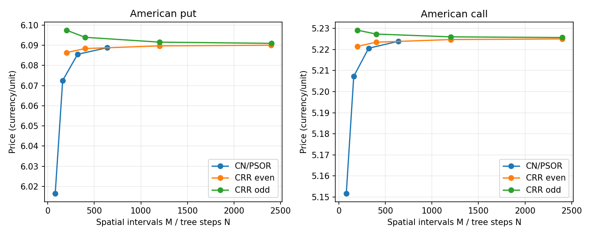
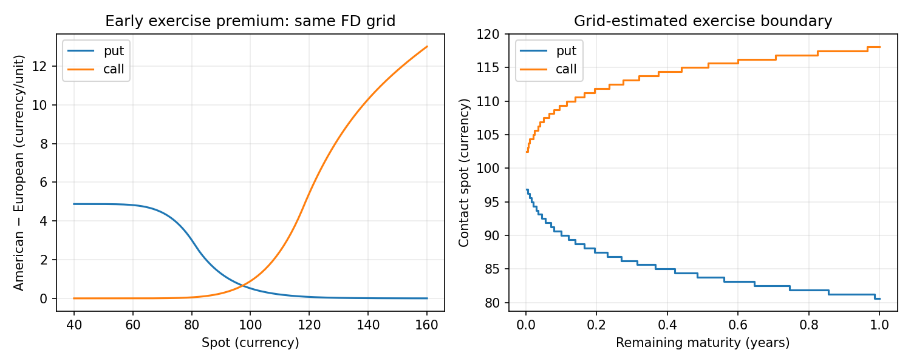
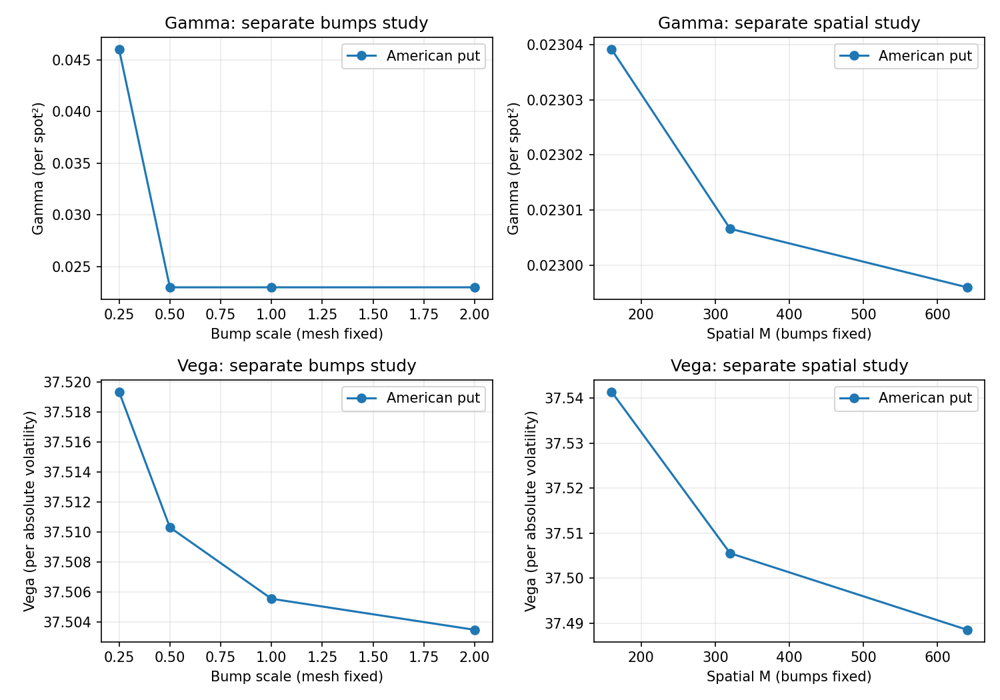
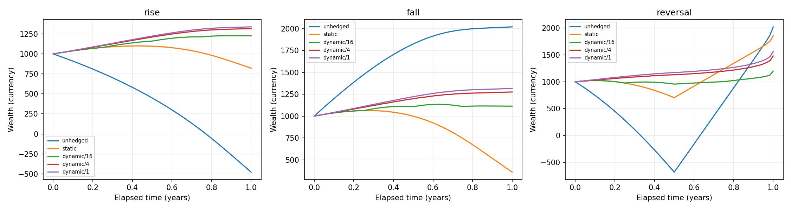

# Abstract

This report presents a reproducible Python implementation of vanilla option
valuation and risk analysis under constant-parameter Black–Scholes–Merton
dynamics with continuous dividends. European analytic prices and Greeks provide
controls for independent Cox–Ross–Rubinstein trees and Crank–Nicolson finite
differences with Rannacher startup. American exercise is treated as an obstacle
problem solved by projected successive over-relaxation, with complementarity
diagnostics and mesh-estimated exercise boundaries. Numerical sensitivity
studies separate perturbation size from spatial and temporal refinement and
retain warnings near interpolation and exercise transitions. Signed portfolio
scenarios account explicitly for expiry settlement, cash financing and local
Greek P&L approximations. Deterministic hedge demonstrations compare unhedged,
static and rebalanced Delta strategies using an auditable self-financing stock
and cash ledger. Automated tests and synthetic experiments accompany tables,
figures and execution provenance. Results are benchmark-specific; grid boundaries,
American sensitivities and individual-path hedge outcomes are not presented as
universal accuracy or performance guarantees.

# Scope, provenance and rights

Software version: **1.0.0**. This synthesis uses the checked-in synthetic
experiments generated with **1.0.0rc1**, retaining their original source hashes,
commit references, warnings and timings. It does not relabel those measurements
as new experiments. The historical implementation reference is
`68aaee42a115667068495f8df7bb2e3d964c9bb8`; release preparation and its full local
validation are recorded at `5732ea3c8730679f9e64b8cd4ca871924a36f0b8`.
Subsequent publication changes do not alter the financial algorithms.

The software is licensed under MIT. This report and its original figures are
licensed under **CC BY-SA 4.0**, Copyright (c) 2026 Matheus de Oliveira Gomes.
Terms: <https://creativecommons.org/licenses/by-sa/4.0/>.
**Zenodo DOI: pending deposit.** No deposit or DOI is claimed in this document.
The software release is identified by the repository tag `v1.0.0` at
<https://github.com/diracadjoint/quant-options-pricing>.

The engine covers one underlying and one currency with constant annualized
volatility, continuously compounded interest and continuous dividend yield.
Spot and strike are strictly positive, remaining maturity and volatility are
nonnegative, and all numeric inputs must be finite. Times are years; rates,
yields and volatility are decimals. Runtime pricing uses the Python standard
library. Plotting dependencies are optional. There are no market observations,
calibration, transaction costs, stock-borrow costs, margin or date conventions.

# Model and independent valuation methods

Under risk-neutral dynamics,

$$dS=(r-q)S\,dt+\sigma S\,dW,\qquad
\mathcal L V=\tfrac12\sigma^2 S^2 V_{SS}+(r-q)S V_S-rV.$$

For European claims with remaining maturity $\tau$, the engine implements

$$d_1=\frac{\log(S/K)+(r-q+\sigma^2/2)\tau}{\sigma\sqrt\tau},\quad
d_2=d_1-\sigma\sqrt\tau,$$
$$C=S e^{-q\tau}N(d_1)-K e^{-r\tau}N(d_2),\qquad
P=K e^{-r\tau}N(-d_2)-S e^{-q\tau}N(-d_1).$$

The normal CDF uses `erfc`. Expiry returns intrinsic payoff, and zero volatility
returns the positive part of the discounted deterministic spot-strike difference.
No arbitrary epsilon replaces a degenerate input. Analytic Greeks are unavailable
at zero maturity or volatility rather than silently replaced with zero.

CRR uses reciprocal up/down factors and validates the risk-neutral probability
without clipping it. American rollback compares continuation against payoff.
Even and odd step counts are studied separately. The finest pair is an
approximate reference, not an exact American price.

The finite-difference engine uses a uniform spot grid, Crank–Nicolson time
integration and four implicit half steps replacing the first two full steps.
Europeans use tridiagonal elimination. Americans solve the obstacle

$$V-g\geq0,\qquad V_\tau-\mathcal LV\geq0,\qquad
(V-g)(V_\tau-\mathcal LV)=0$$

with projected successive over-relaxation. Both update and complementarity
criteria must converge; failures raise exceptions. Drift upwinding is applied
locally when needed for the required spatial sign structure. A small algebraic
residual does not bound domain, discretization or interpolation error. The PDE
currently requires $r,q\geq0$; BSM and CRR accept negative rates/yields.

# Price, domain and exercise-contact validation

The European control at $S=K=100$, $\tau=1$, $r=.05$, $q=0$, $\sigma=.20$
is call **10.450583572185565**, put **5.573526022256971**. Tests include
put–call parity, discounted bounds, degenerate cases and qualitative monotonicity.
Spatial, temporal and upper-domain refinement are varied separately.

For the American benchmarks, $S=K=100$, $\tau=1$, $\sigma=.20$,
$S_{max}=400$, $M=640$ and $N_t=200$:

| Claim | r | q | CN/PSOR | CRR2400/2401 average |
|:---|---:|---:|---:|---:|
| Put | .05 | 0 | 6.08883942 | 6.09051979 |
| Call | .02 | .10 | 5.22387677 | 5.22533078 |

These are historical retained values. Core tests require absolute differences
below .003 against each finest CRR parity for the specified fine-grid cases,
not universal accuracy over all model inputs. Domain expansion at fixed local
spacing includes both puts and dividend calls. The exercise frontier uses
positive-payoff grid contacts and is quantized by mesh spacing. Frontier
stability, value matching and continuation-side slopes have separate checks;
price convergence alone does not certify a free boundary.

{width=90%}

{width=90%}

# Numerical Greeks and portfolio scenarios

Delta, Gamma, Vega, Rho and calendar Theta are computed with explicit derivative
units. Vega/Rho are per absolute unit, and calendar Theta is per year. American
bumps reprice exercise rights. Second-order central stencils are preferred;
documented forward stencils handle parameter boundaries. Unavailable values,
solver diagnostics and exercise-regime warnings remain in returned results.

Bump sensitivity is studied at fixed domain and mesh; spatial and temporal
sensitivity are studied at fixed bumps while varying one resolution at a time.
Linear price interpolation can suppress or amplify Gamma when the spot bump is
smaller than grid spacing. Near exercise transitions, reducing a bump is not
automatically an improvement and no universal smooth Gamma is claimed.

{width=90%}

Portfolio value and each available Greek scale with signed quantity times
positive contract multiplier. Scenario shocks occur immediately and then hold
spot flat through the horizon. Expired options settle once into cash; each
settlement accrues from its expiry at the scenario rate. Already-due positions
settle at the original spot before shocks. Positive and negative cash use the
same rate. Local P&L includes Delta, Vega, Rho and Theta; the second approximation
adds only $\Gamma(\Delta S)^2/2$, omitting cross terms and other second derivatives.
On crossing a live leg's expiry, the local Taylor estimate is explicitly
unavailable while fully repriced settlement P&L remains defined.

# Self-financing Delta hedge accounting

Paths are deterministic and piecewise linear between supplied increasing times.
The desired stock inventory is $H=-\Delta_\Pi$, with

$$W=\Pi+HS+B,\qquad
B_{after}=B_{before}-(H_{new}-H_{old})S.$$

Opening cash finances option value and stock against an explicitly chosen initial
wealth. Trades preserve wealth up to floating-point rounding. Between events,
stock units stay fixed and cash compounds continuously. Nominal stock dividends
use $qH(S_{left}+S_{right})\Delta t/2$, credited at the interval end. This is exact
for the nominal dividend integral along a linear segment, but omits intra-interval
interest on dividends. Negative stock pays dividends. At expiry the option pays
cash once, and the hedge closes at the last expiry or final horizon. Shorter
horizons retain live option marks and an explicit warning.

The ledger separates option P&L, stock P&L, financing and dividends. Unavailable
Delta raises; warned Delta raises by default or must be explicitly allowed and
marked. American observations retain optimally priced exercise rights, but the
demonstration **holds options to expiry without early exercise or assignment**.

The short European call example has quantity -1, multiplier 100, $K=100$,
$\tau=1$, $\sigma=.20$, $r=.05$, $q=.02$, initial wealth 1000 and 65 observations.
Historical final wealth is:

| Path | Unhedged | Static | Dynamic every observation |
|:---|---:|---:|---:|
| Rise | -478.72048394 | 822.74245517 | 1338.92099701 |
| Fall | 2021.27951606 | 358.66054256 | 1315.64159935 |
| Reversal | 2021.27951606 | 1855.73909137 | 1562.73426517 |

Risk-free capitalized wealth is **1051.27109638**. These stress paths do not
reproduce diffusion quadratic variation. Higher rebalance frequency need not
improve every individual path or dominate static/unhedged positions.

{width=90%}

# Reproduction, executed checks and limitations

From a repository checkout, with Python 3.12 for the plotting lock:

```bash
python -m venv .venv
source .venv/bin/activate
python -m pip install -r requirements/visualization-py312.txt
python -m pip install --no-build-isolation .
python -m pytest -q
python examples/reproduce.py --mode full --output work/report-results
python scripts/verify_results.py work/report-results
python scripts/check_report_tables.py work/report-results
```

The release-preparation check on Python 3.12.14 executed all **802 tests** in
303.23 seconds. A wheel installed outside the checkout reported version 1.0.0
and the approved MIT metadata/license file. Historical artifact, accounting,
reference-value and five-report table checks passed. Fast CI passed on Python
3.10, 3.12 and 3.13. New release workflow outcomes are separate observations and
are recorded in GitHub Actions; this report does not preclaim their completion.

Historical artifacts comprise 32 outputs plus a manifest, including nine CSVs
and eight PNG/SVG figure families. The manifest records configuration, source
hashes, versions, environment and individual wall-time samples. New runs use
separate output directories. Wall timings are not isolated benchmarks or speedup
claims. Machine-dependent timing columns are excluded from report-value checks.

Finite floating-point range, tail underflow and subtractive cancellation remain
limitations. Upper PDE boundaries are approximations; exercise contacts and
bumped Greeks need refinement assessment. The implementation does not model
discrete dividends, American assignment, transaction costs, margin, funding
spreads, multi-asset/currency portfolios, stochastic volatility or market data.
The numerical budgets and deterministic path outcomes are benchmark-specific.

# References

- Black, F. and Scholes, M. (1973). The Pricing of Options and Corporate
  Liabilities. *Journal of Political Economy*, 81(3), 637–654.
- Merton, R. C. (1973). Theory of Rational Option Pricing. *Bell Journal of
  Economics and Management Science*, 4(1), 141–183.
- Cox, J. C., Ross, S. A. and Rubinstein, M. (1979). Option Pricing: A Simplified
  Approach. *Journal of Financial Economics*, 7(3), 229–263.
- Repository source, detailed validation reports, artifact data and provenance:
  <https://github.com/diracadjoint/quant-options-pricing/tree/v1.0.0>.
